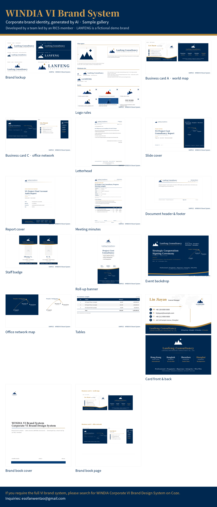

# WINDIA VI Brand System · Sample Gallery

**WINDIA Corporate VI Brand Design System** — an AI system that turns a company's business card, logo and registration documents into a complete, consistent corporate identity, then generates every everyday material from it. Developed by a team led by an RICS member.

This repository is a **showcase only**. It contains a Claude skill that presents sample outputs. It does not include the underlying brand rules, the prompt pack or the generator.

## What the system produces

| Output | Sample |
|---|---|
| Brand lockup and logo rules | `brandlockup.png`, `logospec.png` |
| Business card A (world-map texture) and C (office network) | `businesscard.png`, `businesscardc.png`, `card-a-front-back.png` |
| Letterhead, document header and footer | `letterhead.png`, `docheader.png` |
| Slide cover, report cover, meeting minutes | `slidetitle.png`, `reportcover.png`, `meetingminutes.png` |
| Staff badge, roll-up banner, event backdrop | `workbadge.png`, `rollupbanner.png`, `backdrop.png` |
| Office-network map, tables | `officemap.png`, `table.png` |
| Bilingual brand book | `brand-book-cover.png`, `brand-book-page.png` |

All samples are in [`skills/windia-vi-showcase-en/assets/showcase/`](skills/windia-vi-showcase-en/assets/showcase/). The demo brand "LANFENG Engineering Consultancy" is fictional, and so are all names, phone numbers, e-mail addresses and street addresses.

## Use the showcase skill

- **Claude (app):** download this repository as a ZIP, keep only the `skills/windia-vi-showcase-en` folder, zip it, and upload it under Settings → Skills. Then ask, for example, "Show me what the WINDIA VI Brand System can produce."
- **Claude Code:** `/plugin marketplace add tinofan87-tinooo/windia-vi-brand-system`, then `/plugin install windia-vi-brand-system@windia-vi`.
- **Other assistants:** paste `skills/windia-vi-showcase-en/SKILL.md` as the instructions and upload the images in `assets/showcase/` as knowledge.

## Notice

© 2026 WINDIA. All rights reserved. The sample images are provided for preview only and may not be resold or used as a brand identity.

If you require the full VI brand system, please search for WINDIA Corporate VI Brand Design System on Coze. Inquiries: esofanwentao@gmail.com
